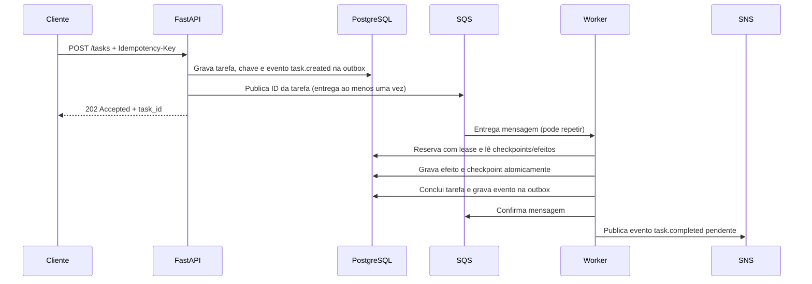

# Plataforma assíncrona SupportOps

Serviço FastAPI e worker instaláveis de forma independente para fluxos de suporte duráveis e assíncronos. A demonstração local usa um runner fake determinístico e não chama modelo nem nuvem.

## Arquitetura



## Executar a demonstração determinística

```sh
uv sync --locked
uv run --locked python scripts/demo.py
```

O pacote de runtime instalável tem versão `0.1.1`. Gere um wheel local sem publicá-lo:

```sh
uv build --wheel --out-dir artifacts/packages
```

Executar a recuperação após encerramento abrupto:

```sh
uv run --locked pytest -q --basetemp artifacts/evidence/.pytest-tmp tests/recovery/test_process_recovery.py
```

O teste encerra um processo filho depois de gravar efeito e checkpoint, aguarda a expiração do lease e inicia outro worker. A asserção confirma que o efeito persistido não se repete.

## Executar PostgreSQL e LocalStack

```sh
docker compose -f docker-compose.async.yml config
docker compose -f docker-compose.async.yml up --build
```

Crie uma tarefa e consulte seu estado:

```sh
curl -i -X POST http://localhost:8000/tasks -H "Content-Type: application/json" -H "Idempotency-Key: local-001" -d '{"payload":{"ticket_id":"T-100"},"steps":["triage","draft_reply"]}'
curl http://localhost:8000/tasks/<task_id>
```

Para observar recuperação durante uma operação fake longa, envie `"step_delay_seconds":20` com duas etapas. Depois que a primeira terminar e a segunda começar, execute `docker compose -f docker-compose.async.yml kill -s SIGKILL worker` e `docker compose -f docker-compose.async.yml up -d worker`. A visibilidade do SQS e o lease do banco atrasam a nova entrega até a expiração da posse; o próximo worker ignora efeitos já gravados. Mantenha isso local. O cancelamento é observado entre etapas; uma etapa em execução não é interrompida à força.

## Estados da tarefa

`queued → running → done | failed`; falhas transitórias passam por `retrying`. Tarefas em `queued`, `retrying` ou `running` podem ser canceladas. Repetir `Idempotency-Key` retorna o mesmo ID mesmo que o payload mude; clientes devem reutilizar uma chave apenas para a mesma solicitação lógica.

## Entrega e falhas

O SQS entrega ao menos uma vez. A chave idempotente deduplica o envio; cada efeito `(task_id, step)` e checkpoint são gravados juntos. Isso garante execução única no ledger fake local. Efeitos externos reais ainda precisam de chave idempotente própria ou transação compartilhada; a plataforma não promete entrega universal exatamente uma vez. Falhas transitórias usam atraso exponencial limitado; falhas permanentes ou esgotadas vão para a DLQ. Eventos SNS usam uma outbox transacional, e eventos pendentes podem ser reenviados.

## Estado das validações

Testes unitários e de recuperação em subprocesso usam SQLite e broker em memória. Eles não aprovam integração PostgreSQL/LocalStack nem E2E completa. Esses gates ficam INCOMPLETE até execução contra serviços locais. Validação/plan do Terraform e build da imagem também ficam INCOMPLETE quando ferramentas ou daemon não estão disponíveis. Não há métricas de LLM real; `LLM_MODE=fake`, e qualidade/custos de modelo ficam PENDING.

## Infraestrutura e autorização

Os arquivos Terraform descrevem SQS, SNS e política mínima do worker usando endpoint LocalStack. Os comandos em `infra/terraform/README.md` são somente de planejamento. Deploy na AWS, push da imagem ou `terraform apply` ficam fora da demonstração e exigem autorização específica.
